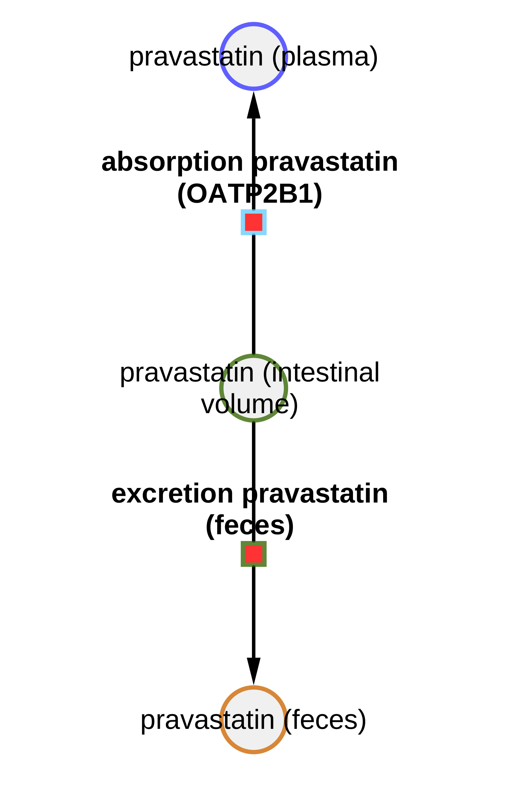

# Models

The models are distributed in [SBML](http://sbml.org) format.

## pravastatin_body_all

* Model: [`pravastatin_body_all.xml`](https://raw.githubusercontent.com/matthiaskoenig/pravastatin-model/main/models/pravastatin_body_all.xml)
* Equations: [`pravastatin_body_all.md`](https://github.com/matthiaskoenig/pravastatin-model/blob/main/models/pravastatin_body_all.md)
* Report: [SBML4humans](https://sbml4humans.de/report?url=https%3A%2F%2Fraw.githubusercontent.com%2Fmatthiaskoenig%2Fpravastatin-model%2Fmain%2Fmodels%2Fpravastatin_body_all.xml)

## pravastatin_body_all_flat

* Model: [`pravastatin_body_all_flat.xml`](https://raw.githubusercontent.com/matthiaskoenig/pravastatin-model/main/models/pravastatin_body_all_flat.xml)
* Equations: [`pravastatin_body_all_flat.md`](https://github.com/matthiaskoenig/pravastatin-model/blob/main/models/pravastatin_body_all_flat.md)
* Report: [SBML4humans](https://sbml4humans.de/report?url=https%3A%2F%2Fraw.githubusercontent.com%2Fmatthiaskoenig%2Fpravastatin-model%2Fmain%2Fmodels%2Fpravastatin_body_all_flat.xml)

## pravastatin_body_pravastatin

* Model: [`pravastatin_body_pravastatin.xml`](https://raw.githubusercontent.com/matthiaskoenig/pravastatin-model/main/models/pravastatin_body_pravastatin.xml)
* Equations: [`pravastatin_body_pravastatin.md`](https://github.com/matthiaskoenig/pravastatin-model/blob/main/models/pravastatin_body_pravastatin.md)
* Report: [SBML4humans](https://sbml4humans.de/report?url=https%3A%2F%2Fraw.githubusercontent.com%2Fmatthiaskoenig%2Fpravastatin-model%2Fmain%2Fmodels%2Fpravastatin_body_pravastatin.xml)

## pravastatin_body_pravastatin_flat

* Model: [`pravastatin_body_pravastatin_flat.xml`](https://raw.githubusercontent.com/matthiaskoenig/pravastatin-model/main/models/pravastatin_body_pravastatin_flat.xml)
* Equations: [`pravastatin_body_pravastatin_flat.md`](https://github.com/matthiaskoenig/pravastatin-model/blob/main/models/pravastatin_body_pravastatin_flat.md)
* Report: [SBML4humans](https://sbml4humans.de/report?url=https%3A%2F%2Fraw.githubusercontent.com%2Fmatthiaskoenig%2Fpravastatin-model%2Fmain%2Fmodels%2Fpravastatin_body_pravastatin_flat.xml)

## pravastatin_intestine

* Model: [`pravastatin_intestine.xml`](https://raw.githubusercontent.com/matthiaskoenig/pravastatin-model/main/models/pravastatin_intestine.xml)
* Equations: [`pravastatin_intestine.md`](https://github.com/matthiaskoenig/pravastatin-model/blob/main/models/pravastatin_intestine.md)
* Report: [SBML4humans](https://sbml4humans.de/report?url=https%3A%2F%2Fraw.githubusercontent.com%2Fmatthiaskoenig%2Fpravastatin-model%2Fmain%2Fmodels%2Fpravastatin_intestine.xml)

{ style="max-height: 420px; width: auto; max-width: 100%" }

## pravastatin_kidney

* Model: [`pravastatin_kidney.xml`](https://raw.githubusercontent.com/matthiaskoenig/pravastatin-model/main/models/pravastatin_kidney.xml)
* Equations: [`pravastatin_kidney.md`](https://github.com/matthiaskoenig/pravastatin-model/blob/main/models/pravastatin_kidney.md)
* Report: [SBML4humans](https://sbml4humans.de/report?url=https%3A%2F%2Fraw.githubusercontent.com%2Fmatthiaskoenig%2Fpravastatin-model%2Fmain%2Fmodels%2Fpravastatin_kidney.xml)

## pravastatin_liver_all

* Model: [`pravastatin_liver_all.xml`](https://raw.githubusercontent.com/matthiaskoenig/pravastatin-model/main/models/pravastatin_liver_all.xml)
* Equations: [`pravastatin_liver_all.md`](https://github.com/matthiaskoenig/pravastatin-model/blob/main/models/pravastatin_liver_all.md)
* Report: [SBML4humans](https://sbml4humans.de/report?url=https%3A%2F%2Fraw.githubusercontent.com%2Fmatthiaskoenig%2Fpravastatin-model%2Fmain%2Fmodels%2Fpravastatin_liver_all.xml)

## pravastatin_liver_cholesterol

* Model: [`pravastatin_liver_cholesterol.xml`](https://raw.githubusercontent.com/matthiaskoenig/pravastatin-model/main/models/pravastatin_liver_cholesterol.xml)
* Equations: [`pravastatin_liver_cholesterol.md`](https://github.com/matthiaskoenig/pravastatin-model/blob/main/models/pravastatin_liver_cholesterol.md)
* Report: [SBML4humans](https://sbml4humans.de/report?url=https%3A%2F%2Fraw.githubusercontent.com%2Fmatthiaskoenig%2Fpravastatin-model%2Fmain%2Fmodels%2Fpravastatin_liver_cholesterol.xml)

## pravastatin_liver_pravastatin

* Model: [`pravastatin_liver_pravastatin.xml`](https://raw.githubusercontent.com/matthiaskoenig/pravastatin-model/main/models/pravastatin_liver_pravastatin.xml)
* Equations: [`pravastatin_liver_pravastatin.md`](https://github.com/matthiaskoenig/pravastatin-model/blob/main/models/pravastatin_liver_pravastatin.md)
* Report: [SBML4humans](https://sbml4humans.de/report?url=https%3A%2F%2Fraw.githubusercontent.com%2Fmatthiaskoenig%2Fpravastatin-model%2Fmain%2Fmodels%2Fpravastatin_liver_pravastatin.xml)

## COMBINE archive

The models and the metadata are available as COMBINE archive from [`pravastatin_model.omex`](https://raw.githubusercontent.com/matthiaskoenig/pravastatin-model/main/pravastatin_model.omex).
